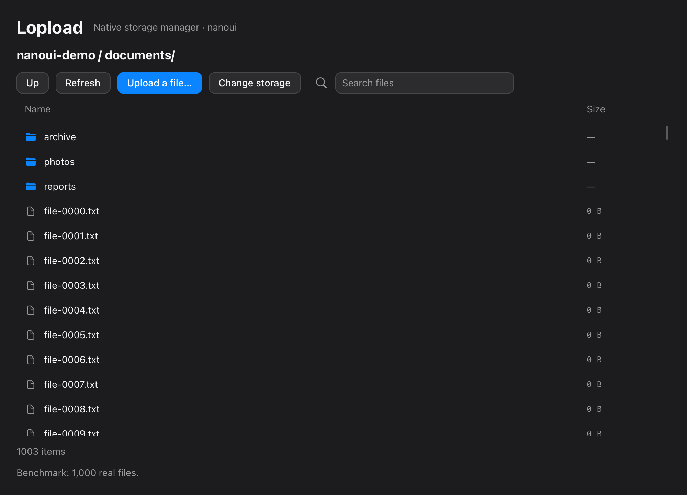
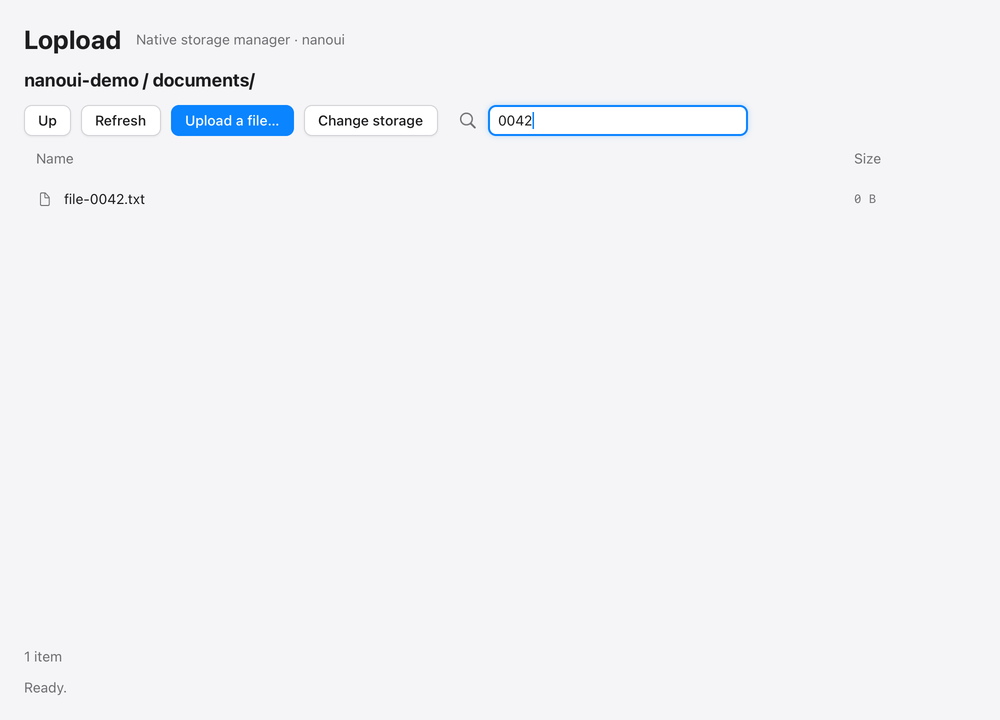
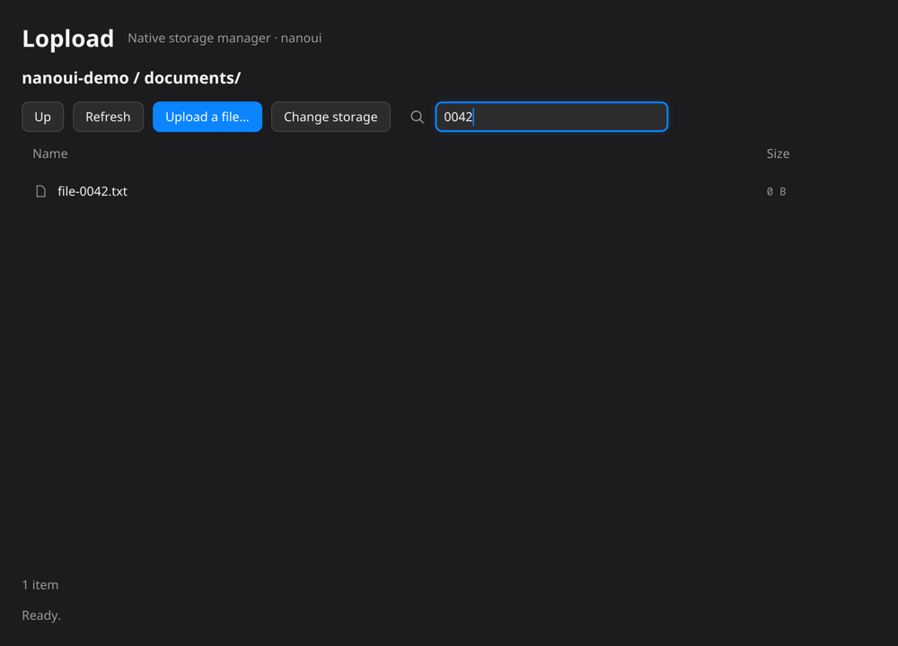

# Lopload storage browser on nanoui (spike)

[nanoui](https://github.com/justrach/nanoui) is a desktop framework in Zig: native UI drawn with Metal on macOS (CPU renderer on Linux/Windows), no webview, no JavaScript. It began as a Zig port of the core of MyGo. This spike rebuilds the S3-only MyGo spike (`../spike-mygo-native/S3-ONLY.md`) on nanoui to compare size, memory and effort. Production Lopload on `main` is unchanged.

nanoui is pinned to commit `89689589abdd1d2e1ac13b240c1c2a3655788c0c` (v0.1.0, 12 commits, one author, MIT). It needs **Zig 0.17.0**; the Homebrew `zig` here is 0.16.0, so the toolchain was downloaded separately and checksum-verified.

## What works

- Connect to S3-compatible storage (address, bucket, access ID, secret).
- Browse folders (double-click, or select and press Enter; `Up` button), refresh, and search.
- A virtualized file list: 2,501 real rows build under 400 UI nodes.
- Arrow-key selection.
- Upload through a native file dialog with progress, a Cancel button and a status line.
- Verified uploads: SHA-256 of the local file, upload, then a complete remote readback compared against it before showing `Uploaded ✓`. Existing destinations are refused.
- Real HTTP statuses become messages (`403` → access denied, `404` → storage name not found).
- Network work runs on a worker thread. While a job runs, a 100 ms timer on the UI thread repaints the progress and finishes the job; with no job running nothing is scheduled. This uses only `App.after`, which exists on every platform.

The S3 client (`src/s3.zig`, about 420 lines) is written here on Zig's standard library: SigV4 signing, ListObjectsV2 with pagination, streaming PUT, HEAD, GET, DELETE. There is no AWS SDK equivalent in Zig to depend on.

## Not done (compared with the MyGo spikes)

- **No keychain.** Credentials live only in memory for the session. Calling Security.framework from Zig is possible through nanoui's Objective-C layer but was not attempted; shelling out to `security` would put the secret on a command line.
- **Single-request upload.** No multipart, so the 5 GiB single-PUT limit applies again. The body is sent as `UNSIGNED-PAYLOAD` (valid for S3; the readback provides the integrity check).
- **S3 only.** No rclone: it is a Go library, so none of its 69 providers come with this approach. Each provider would be new Zig code, or an rclone sidecar process.
- **No copy, rename, delete, download, new folder, bulk actions.**
- Only MinIO was tested, not AWS S3 or any other service. The hand-written client has had no exposure to provider quirks.
- **Linux**: the aarch64 build ran in nanoui's own Ubuntu 24.04 + GTK + Xvfb container with its CPU renderer, and the same scripted flow (connect to MinIO over the network, open a folder, search) rendered correctly (`results/screenshots/linux-flow.png`). x86_64 Linux cross-compiles but was never launched. **Windows** (`x86_64-windows-gnu`, 1.1 MB exe): launched by the owner on a Windows machine, rendered correctly and reported working against MinIO over the network; the individual checks (file dialog, upload, cancel) were not itemized or recorded. The first Windows build opened a console window behind the app because Zig links Windows executables as console programs by default; `build.zig` now sets `exe.subsystem = .windows`, and the window was always light there because nanoui's Windows `isDark()` is hard-coded to `false`. The native file dialog on macOS, real keyboard input and the benchmark were only exercised on macOS.
- No accessibility. nanoui's own README lists it, bundling, notifications, auto-update and plugins as missing. There is no `.app` bundler: the output is a bare, ad hoc signed executable.

## Run

Needs Zig 0.17.0 and, for tests and the benchmark, the repository's MinIO on port 9400 (`bun test` starts it when Docker is running, or `docker start lopload-test-minio`).

```sh
zig build run                      # debug
zig build -Doptimize=ReleaseSmall  # zig-out/bin/lopload-nanoui
zig build test                     # 10 tests against real MinIO
```

The connect screen defaults to `http://127.0.0.1:9400`; the local test credentials are `minioadmin` / `minioadmin`.

## Tests

`zig build test` runs 10 tests with no storage or HTTP doubles, and each owns a fresh bucket:

- signing accepted by MinIO, and a wrong secret refused with a 403;
- folders-first listing with sizes and prefixes;
- keys with spaces, accents, `& < >`, `+ = ~` and Japanese text sign, store and list correctly;
- pagination across 1,105 keys;
- an uploaded 12 MiB file matches what a separate read returns;
- an existing destination is refused and left untouched;
- verification fails when the stored bytes differ by one bit;
- cancel before the transfer, and cancel during a 256 MiB upload: no object is stored and the client stays usable;
- the actual native view (nanoui's offscreen `ui.Tester`) over a real 2,501-entry listing: virtualization, arrow keys, and typing in the search field.

Not covered by tests: the native file dialog, and clicking through a live window with a real pointer and keyboard. The screenshots below come from nanoui's offscreen renderer, driven by its script runner (`--nanoui-script`), not from a screen capture. The script connects to MinIO, selects a folder, opens it with Enter and searches. The Linux image is the same script on the Linux build.

| Browse a 1,003-entry folder (macOS) | Connect, open folder, search `0042` (macOS) | Same flow, Linux/CPU renderer |
| --- | --- | --- |
|  |  |  |

## Loaded-app benchmark

Same scenario and same `measure.py` as the MyGo spikes: 1,000 real empty files listed, 15 s idle, a 1 GiB (sparse) file hashed, uploaded and read back, 10 s idle.

```sh
zig build -Doptimize=ReleaseSmall -p /tmp/nanoui-small
python3 measure.py /tmp/nanoui-small/bin/lopload-nanoui /tmp/nanoui-results
```

| Measurement | MyGo S3-only | MyGo + all rclone backends | **nanoui (ReleaseSmall, 3 runs)** |
| --- | ---: | ---: | ---: |
| Shipped artifact | 13.9 MB `.app` | 73.6 MB `.app` | **0.73 MB executable** (0.35 MB gzipped), no bundle |
| Disk image | 4.3 MB | 18.1 MB | not built (no bundler) |
| macOS physical footprint, idle snapshot | 60.2 MB | 78.4 MB | **49.0 – 49.3 MB** |
| Median idle RSS | 62.7 MB | 54.8 MB (55–81 across runs) | **57.8 – 58.3 MB** |
| Max sampled RSS during the 1 GiB upload | 97.2 MB | 88.4 MB (88–127) | **57.8 – 59.6 MB** |
| Hash/upload/full verification interval | 8.84 s | 19.96 s (16.8–31.8) | **4.60 – 5.62 s** |

ReleaseFast was also measured once: 1.41 MB executable, 58.0 MB idle RSS, 49.5 MB idle footprint, 4.66 s interval, i.e. no meaningful benefit over ReleaseSmall here. The largest RSS sample in any run was 65–68 MB, during fixture setup (seeding the 1,000 files) before the idle phase, which the earlier spikes' tables also exclude. Raw data is in `results/` (`small`, `small-2`, `small-3`, `fast`).

How to read this:

- **Size is the clear win**: the binary is about 19x smaller than the S3-only MyGo `.app` and 100x smaller than the rclone one. It links 13 system libraries and ships no Go runtime.
- **Memory is mostly unchanged.** A trivial nanoui window (the repo's `counter` example) already sits at 59.2 MB RSS (20 MB physical footprint), so RSS is dominated by AppKit and Metal rather than the app. RSS and footprint are different measures, as noted in the earlier spikes. I did not investigate why the app's footprint (about 49 MB) is higher than the counter's (20 MB); window size, Metal drawables, the HTTP client and the listing are candidates.
- **Upload memory is much lower and flat** because the whole transfer streams through two 256 KiB buffers. The earlier spikes ran a different engine (MinIO Go SDK, rclone) and are not the same implementation, so this is not an apples-to-apples engine comparison.
- **The speed difference is mostly not nanoui.** The interval includes local hashing and the full readback and depends on SHA-256 speed, the client, and a loopback MinIO. It should not be read as a framework result.
- Measured on the same Apple Silicon Mac and macOS 15.3.1 as before, but on 2026-10-19 rather than 2026-10-09, so machine load is not controlled. These are figures for this spike, not for production Lopload.

## Effort and risk notes

- Everything above is about 1,200 lines of Zig: S3 client 420, app 460, tests 240, benchmark 110. The hardest parts were not the UI but the `std.http` client in Zig 0.17: a `204 No Content` reply made `Request.deinit` wait 30 s for a body that never comes (DELETE; worked around in `Client.simple`), and PUT requires a body even when empty.
- nanoui's immediate-mode API was quick to learn from its gallery example. One trap: only Up/Down, Tab, Esc and Cmd/Ctrl combinations are offered as shortcuts; plain Enter arrives as `c.input.key`. The offscreen `Tester` made it possible to catch this without a window.
- Maturity is the main question: a very young framework, a single maintainer, a pre-1.0 language whose standard library changes between releases (the project pins `minimum_zig_version = 0.17.0`), and none of the product features Lopload needs beyond the file browser (tray, updater, notifications, accessibility, bundling).
- nanoui also has a webview mode on macOS. That would keep the existing React UI but only on macOS, so it does not address the cross-platform goal; not evaluated here.
